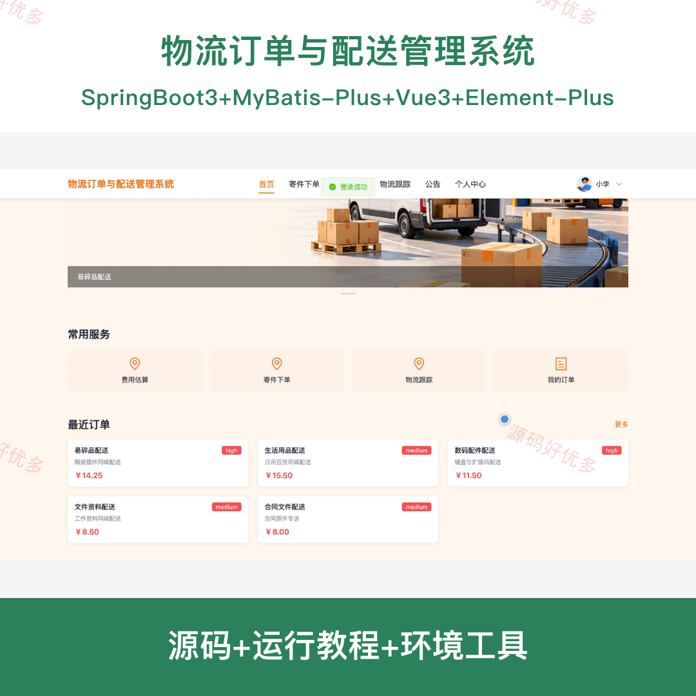
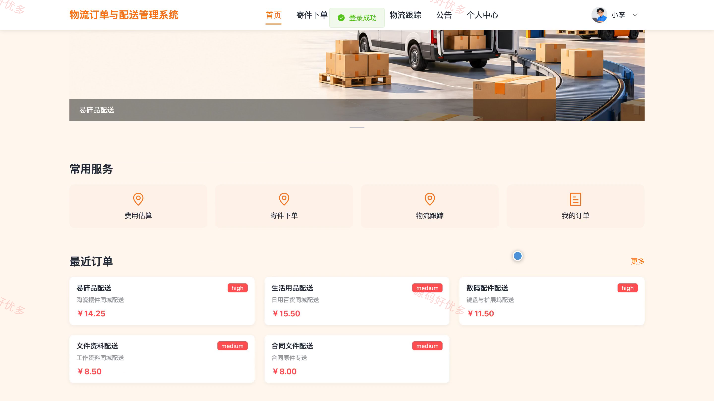
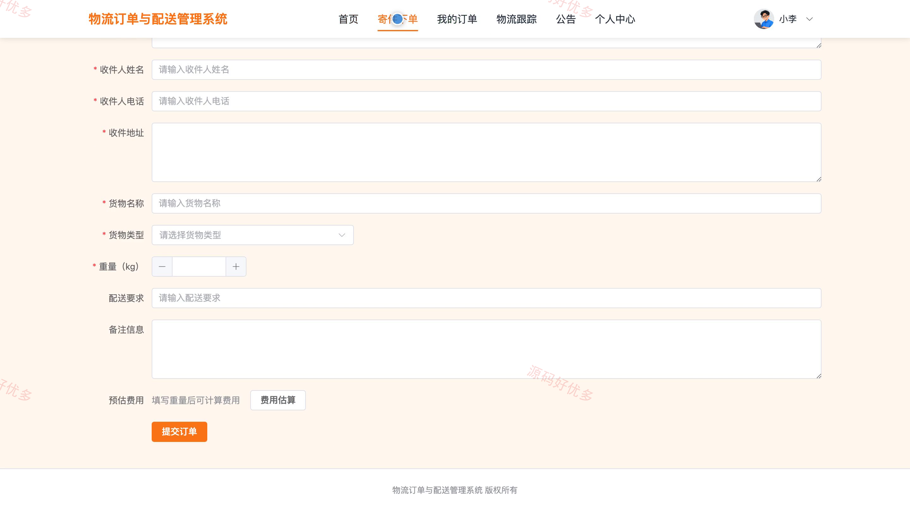
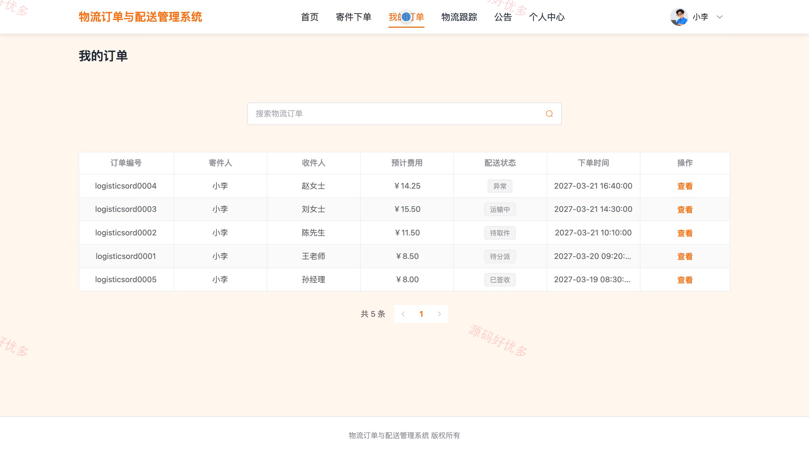
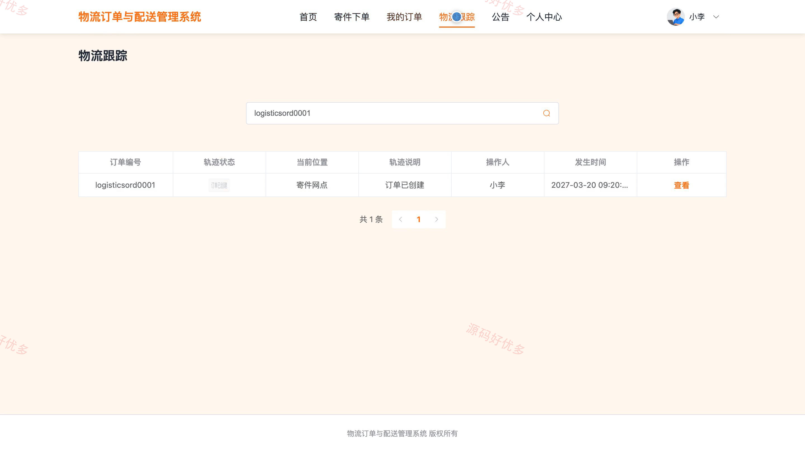
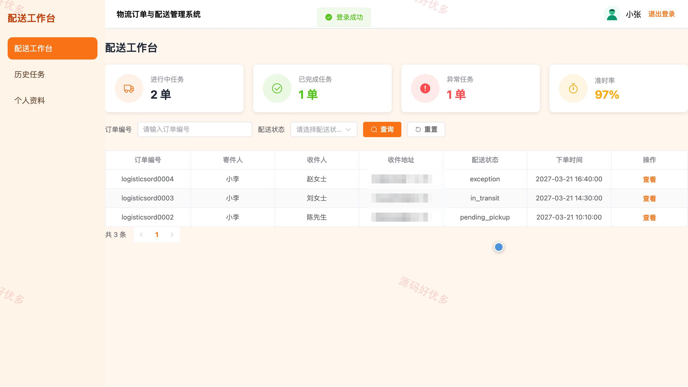
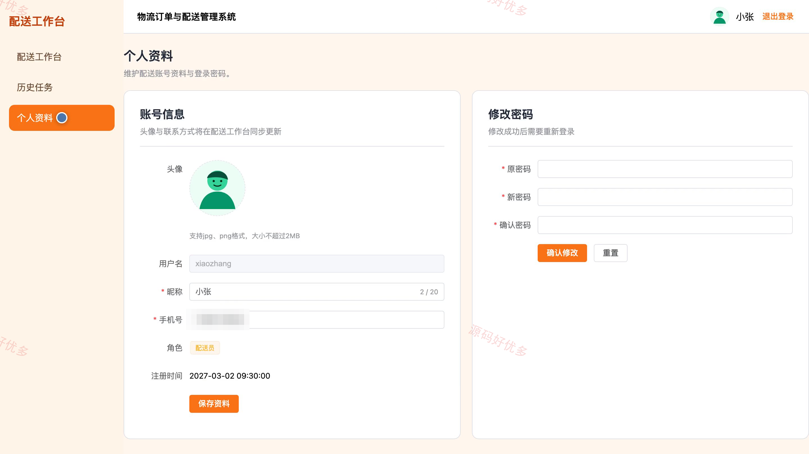
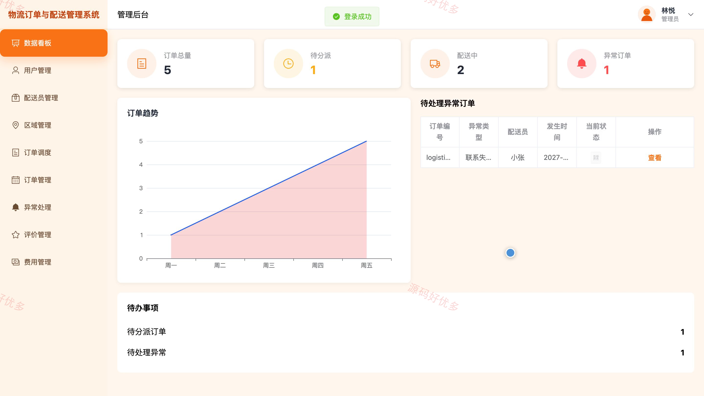
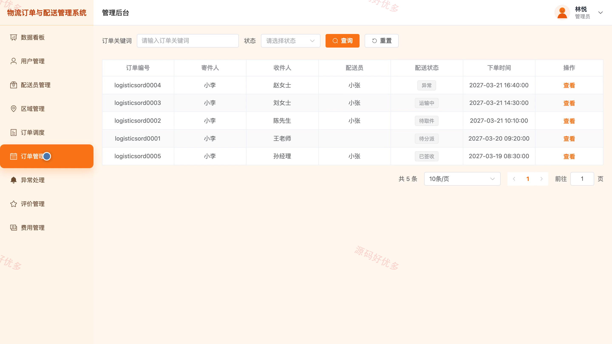

## 源码问题查看主页咨询

### 一、关键词
物流订单、同城配送、寄件下单、配送调度、物流跟踪

### 二、作品包含
源码+数据库+全套环境和工具资源+本地部署教程

### 三、项目技术
前端技术： Html、Css、Js、Vue3.4、Element-Plus
后端技术：Java、SpringBoot3.2.0、MyBatis-Plus

### 四、运行环境要求
开发工具：IDEA/eclipse + VSCODE

数据库：MySQL5.7+（共8张表）

数据库管理工具：Navicat10以上版本

环境配置软件： JDK17 + Maven3.6

前端Nodejs：16+

浏览器：谷歌浏览器

### 五、项目介绍
项目编号：bs136A

系统面向货主用户、配送员和管理员，支持寄件下单、订单查询与物流跟踪，配送员处理取件、运输、异常上报和签收，管理员维护用户、配送区域、订单调度及费用规则等业务数据。

角色：用户、配送员、管理员

用户功能：寄件下单、我的订单查询、物流跟踪、订单取消、地址簿管理、个人中心。

配送员功能：配送任务查询、取件登记、运输进度更新、异常上报、签收登记、历史任务查询。

管理员功能：数据看板、用户与配送员管理、配送区域与费用规则管理、订单调度、异常订单处理、配送评价查看、公告管理。

### 六、运行截图

